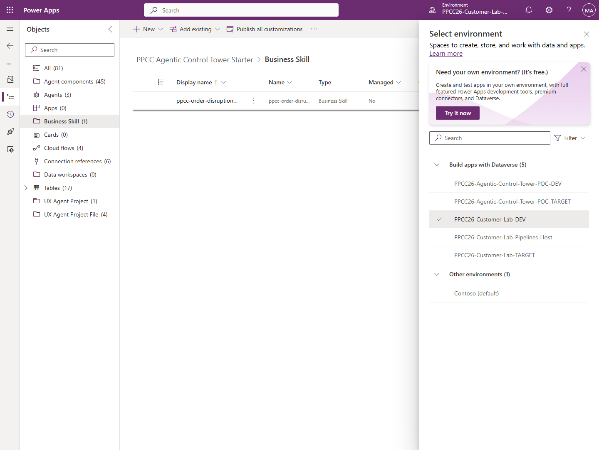
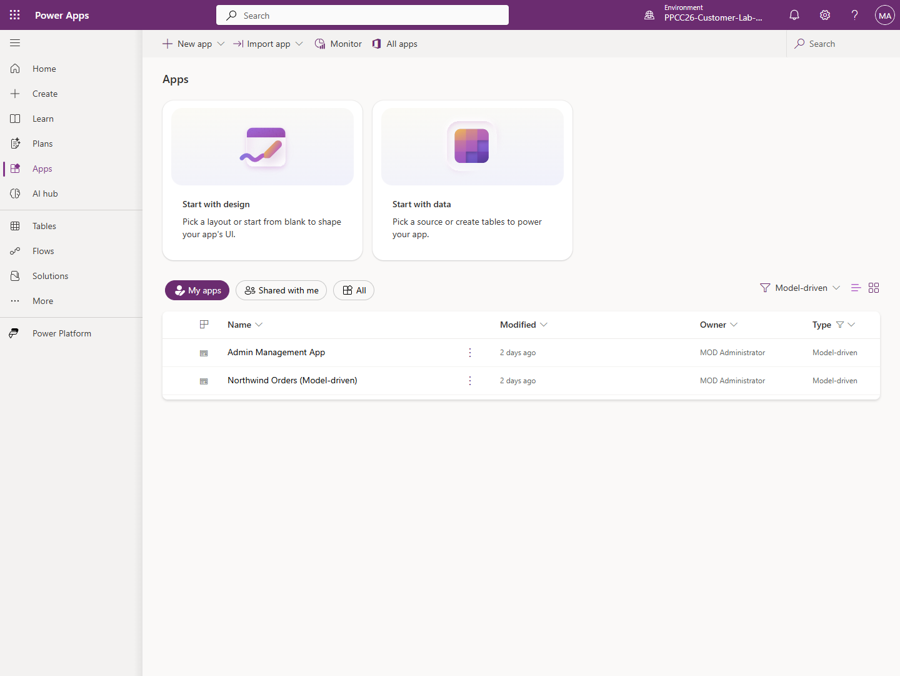

# Module 1: Open the environment and understand the mission

**Estimated time:** 15 minutes

## What the facilitator provides

Your workshop access card must contain:

- your workshop Microsoft 365 account,
- DEV environment `PPCC26-Customer-Lab-DEV`,
- TARGET environment `PPCC26-Customer-Lab-TARGET`,
- the workshop mailbox address.

The facilitator provides only infrastructure, data, connections, the app shell,
the Pipeline, and the low-level carrier adapter. You will create the page,
Workflows, Business Skill, agents, and Computer Use tool.

## Open the DEV app shell

1. Go to <https://make.preview.powerapps.com>.
2. Sign in with the workshop account.
3. In the upper-right suite header, select the environment button.
4. In **Select environment**, enter `PPCC26-Customer-Lab-DEV` in **Search**.
5. Under **Build apps with Dataverse**, select
   **PPCC26-Customer-Lab-DEV**.
6. Confirm the header reads
   **Environment PPCC26-Customer-Lab-DEV**.



7. Select **Apps**.
8. Find **Admin Management App**.
9. Select **Play**. If Play is hidden, select the app's **...** menu, then
   select **Play**.
10. Confirm the header reads **Admin Management App**.



## Inspect the business data

1. In the app's left navigation, select **Order Details**.
2. Use the view search/filter to find product
   **Northwind Traders Clam Chowder**.
3. Locate these three order lines:

   | Order | Quantity | Unit price | Calculated exposure |
   | --- | ---: | ---: | ---: |
   | `0915` | `50` | `9.65` | `USD 482.50` |
   | `0920` | `30` | `9.65` | `USD 289.50` |
   | `0935` | `10` | `9.65` | `USD 96.50` |

4. Add the three exposures:

   ```text
   482.50 + 289.50 + 96.50 = 868.50
   ```

5. Record `USD 868.50` in your lab notes.
6. Select **Purchase Orders**.
7. Confirm there is no participant-created Purchase Order whose number begins
   with `CL`.

## Understand the authority boundary

Write these three lines in your lab notes:

1. **The system may prepare:** detect the delay, calculate impact, apply policy,
   rank work, and draft communications.
2. **A person must decide:** approve, reject, or request revision for one exact
   recovery action.
3. **The system may execute after approval:** update Dataverse, register the
   carrier contact with Computer Use, write CP7 evidence, and resolve the case.

## Checkpoint

You are ready to build when:

- the DEV environment is correct,
- Admin Management App opens,
- orders 0915, 0920, and 0935 contain Clam Chowder,
- the calculated total is `USD 868.50`,
- no participant `CL` Purchase Order exists.

If the data does not match, stop. Ask the facilitator to restore the
`participant-start` checkpoint; do not edit Northwind baseline data manually.
